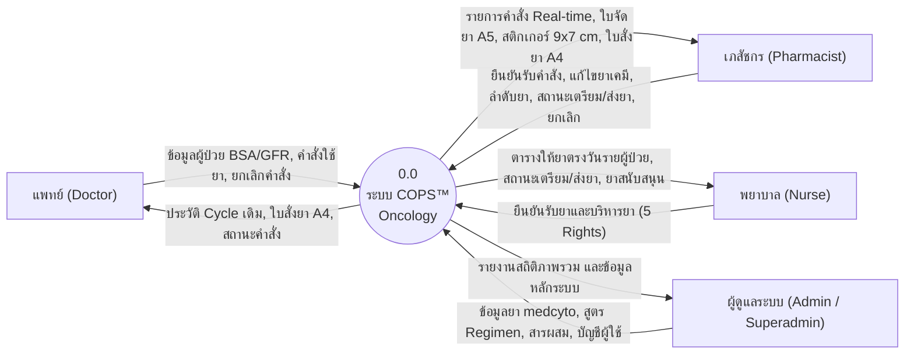
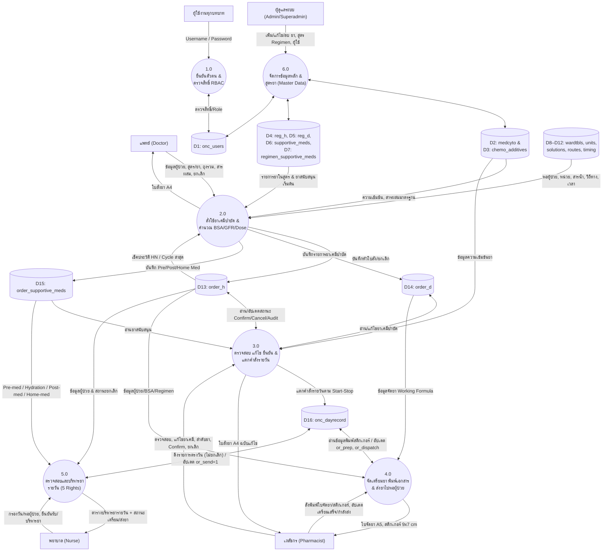

# เอกสารแผนภาพกระแสข้อมูล (DFD) และพจนานุกรมข้อมูล (Data Dictionary)

> **ระบบ:** COPS™ Oncology (Chemotherapy Ordering & Preparation System)  
> **ฐานข้อมูล:** MySQL — `oncospr` (`utf8mb4_unicode_ci`)  
> **หน่วยงาน:** Sterile Products Pharmacy Service, SPR Hospital  
> **เวอร์ชันเอกสาร:** Version 2.3 (22 พฤศจิกายน 2026)  
> **หมายเหตุ:** เอกสารฉบับนี้แยกต่างหากจากเอกสารงานพัฒนาระบบหลัก (`COPS_System_Documentation.md`) เพื่อใช้สำหรับงานออกแบบ วิเคราะห์ฐานข้อมูล และส่งมอบโครงการ

---

## ส่วนที่ 1: แผนภาพกระแสข้อมูล (Data Flow Diagram — DFD)

### 1.1 DFD Level 0 (Context Diagram)

แสดงภาพรวมการไหลของข้อมูลระหว่าง **บุคคลภายนอก (External Entities)** ทั้ง 4 บทบาท กับระบบ **COPS™ Oncology**



#### คำอธิบายองค์ประกอบ DFD Level 0
- **แพทย์ (Doctor):** ส่งคำสั่งใช้ยาเคมีบำบัดพร้อมข้อมูลผู้ป่วย (น้ำหนัก ส่วนสูง SCr), เลือกสูตร Regimen หรือสั่งอิสระ, กำหนดถุงรวม/สารผสม และสามารถยกเลิกคำสั่งได้ โดยรับประวัติ Cycle เดิมและใบสั่งยาเต็มรูปแบบ (A4) กลับไป
- **เภสัชกร (Pharmacist):** รับคำสั่งจากแพทย์แบบ Real-time, ตรวจสอบ/แก้ไขรายการยาเคมีบำบัดหลังปรึกษาแพทย์, กด Confirm แตกคำสั่งรายวัน, พิมพ์ใบจัดยา (A5 แนวนอน) และสติกเกอร์ขนาด 9×7 cm, อัปเดตสถานะเตรียมยาเสร็จ/กำลังส่งยา และสามารถยกเลิกคำสั่งได้
- **พยาบาล (Nurse):** รับข้อมูลตารางให้ยาเฉพาะที่ตรงวันจัดกลุ่มตามผู้ป่วยพร้อมสถานะการเตรียม/จัดส่งจากห้องยา และส่งข้อมูลการยืนยันรับยา/บริหารยาครบ 5 Rights กลับเข้าสู่ระบบ
- **ผู้ดูแลระบบ (Admin / Superadmin):** บริหารจัดการข้อมูลหลักของระบบ ได้แก่ บัญชียาเคมีบำบัด (`medcyto`), สูตรยาเคมีบำบัด (`reg_h`, `reg_d`, `regimen_supportive_meds`) และบัญชีผู้ใช้งาน (`onc_users`)

---

### 1.2 DFD Level 1 (System & Database Data Flow)

แสดงรายละเอียดกระบวนการทำงานหลักทั้ง **6 กระบวนการ (Process 1.0 – 6.0)** และการอ่าน/เขียนข้อมูลกับคลังข้อมูล (**Data Stores D1 – D16**) ในฐานข้อมูล `oncospr`



#### คำอธิบายกระบวนการ (Process Specifications)

| รหัส | ชื่อกระบวนการ (Process) | ข้อมูลเข้า (Input Data Flows) | คลังข้อมูลที่ใช้งาน (Data Stores) | ข้อมูลออก (Output Data Flows) |
| :---: | :--- | :--- | :--- | :--- |
| **1.0** | ยืนยันตัวตนและตรวจสิทธิ์ (Auth & RBAC) | Username, Password | `onc_users` | Session ผู้ใช้, สิทธิ์การเข้าถึงตาม Role (`superadmin`, `admin`, `doctor`, `pharmacist`, `nurse`) |
| **2.0** | สั่งใช้ยาเคมีบำบัด (Doctor Ordering) | ข้อมูลผู้ป่วย (HN, Wt, Ht, SCr), สูตรยา/ยาสั่งอิสระ, กลุ่มถุงรวม, สารผสม, ยาสนับสนุน, เหตุผลยกเลิก | อ่าน: `medcyto`, `chemo_additives`, `reg_h`, `reg_d`, `supportive_meds`, `regimen_supportive_meds`, `wardtbls`, `units`, `solutions`, `routes`, `timing`, `order_h`<br>เขียน: `order_h`, `order_d`, `order_supportive_meds` | คำสั่งใช้ยาในฐานข้อมูล, ค่า BSA/GFR/Working mL/Total Vol, ใบสั่งยาเต็มรูปแบบขนาด A4 |
| **3.0** | ตรวจสอบ แก้ไข ยืนยัน และแตกวัน (Verification & Expansion) | การปรับลำดับยา, การแก้ไขยาเคมีบำบัดหลังปรึกษาแพทย์ (Intervention Note), คำสั่ง Confirm, คำสั่งยกเลิก | อ่าน/เขียน: `order_h`, `order_d`, `onc_dayrecord`<br>อ่าน: `order_supportive_meds`, `medcyto`, `chemo_additives` | ตารางคำสั่งใช้ยารายวัน (`onc_dayrecord`) แตกตามช่วง `or_start`–`or_stop`, สถานะ `or_confirm = 1` หรือ `or_cancel = 1` |
| **4.0** | เตรียมยา พิมพ์เอกสาร และจัดส่ง (Preparation & Dispatch) | คำสั่งพิมพ์ใบจัดยา A5, พิมพ์สติกเกอร์ 9×7 cm, กดปุ่ม `เตรียมยาเสร็จ (รอส่ง)` และ `กำลังส่งยาไปหอผู้ป่วย` | อ่าน: `order_h`, `order_d`, `medcyto`, `solutions`, `routes`, `timing`<br>อ่าน/เขียน: `onc_dayrecord`, `order_h` | ใบจัดยา Working Formula (A5 แนวนอนแบบผสานถุงรวม), สติกเกอร์ 9×7 cm (1 ดวง/ถุง + สติกเกอร์สรุป + Barcode), สถานะ `or_prep = 1`, `or_dispatch = 1` พร้อม Timestamp |
| **5.0** | บริหารยาที่หอผู้ป่วย (Nurse Administration) | ตัวกรองวันที่/หอผู้ป่วย/HN, การกดยืนยันรับและบริหารยา (5 Rights) | อ่าน: `order_h`, `order_supportive_meds`, `medcyto`, `wardtbls`<br>อ่าน/เขียน: `onc_dayrecord` | รายการยาเฉพาะที่ตรงวัน (ตัดคำสั่งยกเลิกอัตโนมัติ) จัดกลุ่มตามผู้ป่วยพร้อมสถานะ 4 ขั้นตอน, บันทึก `or_send = 1` |
| **6.0** | จัดการข้อมูลหลัก (Master Data Management) | ข้อมูลยาเคมีบำบัด, สูตรยา Regimen (5 แท็บยาสนับสนุน), บัญชีผู้ใช้งาน | อ่าน/เขียน: `medcyto`, `reg_h`, `reg_d`, `regimen_supportive_meds`, `onc_users` | บัญชียาและสูตรยามาตรฐานที่พร้อมใช้งานในระบบแพทย์และเภสัชกร |

---

## ส่วนที่ 2: พจนานุกรมข้อมูล (Data Dictionary — ฐานข้อมูล `oncospr`)

ฐานข้อมูล `oncospr` ประกอบด้วยตารางหลักของระบบ COPS ทั้งหมด **16 ตาราง** แบ่งเป็น 3 กลุ่ม ดังนี้

### กลุ่มที่ 1: ตารางคำสั่งใช้ยาและการบริหารยารายวัน (Transaction Tables — 4 ตาราง)

#### 1. ตาราง `order_h` (หัวใบคำสั่งใช้ยาเคมีบำบัด — Order Header)
เก็บข้อมูลหัวใบคำสั่งใช้ยา ข้อมูลทางคลินิกของผู้ป่วย (BSA/GFR) สถานะการรับคำสั่ง การแก้ไข และการยกเลิก (Soft Cancel)

| ชื่อฟิลด์ (Column) | ชนิดข้อมูล (Type) | Null | Key | ค่าเริ่มต้น (Default) | คำอธิบาย (Description) |
| :--- | :--- | :---: | :---: | :---: | :--- |
| `or_id` | `varchar(20)` | NO | PRI | - | รหัสเลขที่ใบสั่งยาเคมีบำบัด (Primary Key) รูปแบบ `ORyymmddHHMMSSxxx` |
| `or_guid` | `varchar(50)` | YES | | NULL | รหัสอ้างอิงสากล (UUID) สำหรับป้องกันการส่งซ้ำ |
| `or_hn` | `varchar(10)` | YES | | NULL | รหัสประจำตัวผู้ป่วยโรงพยาบาล (Hospital Number) |
| `or_patname` | `varchar(250)` | YES | | NULL | ชื่อ-นามสกุลผู้ป่วย |
| `or_age` | `int` | YES | | NULL | อายุผู้ป่วย (ปี) ใช้คำนวณ Cockcroft-Gault GFR |
| `or_sex` | `varchar(10)` | YES | | NULL | เพศผู้ป่วย (`M` = ชาย, `F` = หญิง) |
| `or_wt` | `decimal(6,2)` | YES | | `0.00` | น้ำหนักตัวผู้ป่วย (กิโลกรัม) |
| `or_ht` | `decimal(6,2)` | YES | | `0.00` | ส่วนสูงผู้ป่วย (เซนติเมตร) |
| `or_bsa` | `decimal(6,2)` | YES | | `1.00` | พื้นที่ผิวกายผู้ป่วย (Body Surface Area, m²) สูตร Mosteller |
| `or_scr` | `decimal(6,2)` | YES | | NULL | ค่า Serum Creatinine (mg/dL) |
| `or_gfr` | `decimal(8,2)` | YES | | NULL | ค่าอัตราการกรองของไต (CrCl/GFR, mL/min) ใช้คำนวณ Carboplatin AUC |
| `or_reg_code` | `varchar(30)` | YES | | NULL | รหัสสูตรยาเคมีบำบัด (Regimen Code) หรือ `CUSTOM` กรณีสั่งอิสระ |
| `or_cycle` | `int` | NO | | `1` | รอบการรับยาเคมีบำบัด (Cycle Number) |
| `or_image` | `longblob` | YES | | NULL | รูปภาพใบสั่งยาแนบ (รองรับระบบเดิม) |
| `or_date` | `date` | YES | | NULL | วันที่เริ่มให้ยาเคมีบำบัด (Order Start Date) |
| `or_prnflag` | `tinyint` | YES | | `1` | สถานะการพิมพ์ใบสั่งยา (0=ยังไม่พิมพ์, 1=พิมพ์แล้ว) |
| `or_chkflag` | `tinyint` | YES | | `0` | สถานะเภสัชกรตรวจสอบคำสั่งแล้ว (0=ยังไม่ตรวจ, 1=ตรวจแล้ว) |
| `or_prepflag` | `tinyint` | YES | | `0` | สถานะมีการเตรียมยาแล้ว (0=ยังไม่เตรียม, 1=เตรียมแล้ว) |
| `or_sendflag` | `tinyint` | YES | | `0` | สถานะส่งมอบ/บริหารยาแล้ว (0=ยังไม่ส่ง, 1=ส่งแล้ว) |
| `or_ward` | `varchar(4)` | YES | | NULL | รหัสหอผู้ป่วย/คลินิก (อ้างอิง `wardtbls.wd_code`) |
| `or_daily` | `tinyint` | YES | | `0` | สถานะแตกคำสั่งรายวันลง `onc_dayrecord` แล้ว (0=ยัง, 1=แตกแล้ว) |
| `or_hold` | `tinyint` | YES | | `0` | สถานะพักคำสั่งใช้ยาชั่วคราว (Hold) |
| `or_holdnote` | `mediumtext` | YES | | NULL | หมายเหตุการพักยา |
| `or_holddate` | `date` | YES | | NULL | วันที่สั่งพักยา |
| `or_confirm` | `int` | YES | | `0` | สถานะเภสัชกรยืนยันรับคำสั่ง (0=รอรับคำสั่ง, 1=รับคำสั่งแล้ว) |
| `or_cancel` | `tinyint` | NO | | `0` | สถานะยกเลิกคำสั่งใช้ยาแบบไม่ลบข้อมูล (0=ปกติ, 1=ยกเลิกแล้ว) |
| `or_cancel_reason` | `text` | YES | | NULL | เหตุผลการยกเลิกคำสั่งใช้ยา |
| `or_cancelled_by` | `varchar(150)` | YES | | NULL | ชื่อและบทบาทผู้ยกเลิก เช่น `[แพทย์] นพ.ก` หรือ `[เภสัชกร] ภก.ข` |
| `or_cancelled_at` | `timestamp` | YES | | NULL | วันและเวลาที่ทำการยกเลิกคำสั่งใช้ยา |
| `or_adjust_percent` | `decimal(5,2)` | NO | | `0.00` | เปอร์เซ็นต์การปรับลดขนาดยาโดยรวม (%) |
| `or_adjust_reason` | `text` | YES | | NULL | เหตุผลการปรับลดขนาดยาของแพทย์ และ/หรือ บันทึกการปรึกษาแพทย์ (Intervention Note) |
| `or_doctor_id` | `bigint unsigned` | YES | | NULL | รหัสผู้ใช้งานแพทย์ผู้สั่ง (อ้างอิง `onc_users.id`) |
| `or_doctor_name` | `varchar(150)` | YES | | NULL | ชื่อ-สกุลแพทย์ผู้สั่งใช้ยา |
| `or_pharmacist_id` | `bigint unsigned` | YES | | NULL | รหัสผู้ใช้งานเภสัชกรผู้รับ/แก้ไขคำสั่ง (อ้างอิง `onc_users.id`) |
| `or_pharmacist_name` | `varchar(150)` | YES | | NULL | ชื่อ-สกุลเภสัชกรผู้รับ/แก้ไขคำสั่ง |
| `or_confirmed_at` | `timestamp` | YES | | NULL | วันและเวลาที่เภสัชกรกด Confirm รับคำสั่ง |
| `or_imgpath` | `varchar(150)` | YES | | NULL | พาธไฟล์ภาพใบสั่งยา (ถ้ามี) |

---

#### 2. ตาราง `order_d` (รายละเอียดรายการยาเคมีบำบัดในใบสั่งยา — Order Detail)
เก็บรายการยาเคมีบำบัดแต่ละตัวที่แพทย์สั่ง (และเภสัชกรสามารถแก้ไขได้) รองรับกลุ่มถุงรวม (`or_bag_group`) และสารผสมเพิ่มเติมในขวด (`or_additives`)

| ชื่อฟิลด์ (Column) | ชนิดข้อมูล (Type) | Null | Key | ค่าเริ่มต้น (Default) | คำอธิบาย (Description) |
| :--- | :--- | :---: | :---: | :---: | :--- |
| `or_id` | `varchar(20)` | NO | | - | รหัสเลขที่ใบสั่งยา (FK อ้างอิง `order_h.or_id`) |
| `or_medcode` | `varchar(8)` | YES | | NULL | รหัสยาเคมีบำบัด (FK อ้างอิง `medcyto.dg_code`) |
| `or_std_dose` | `decimal(8,2)` | YES | | NULL | ขนาดยาคำนวณเริ่มต้นก่อนปรับลด (Standard Dose, mg) |
| `or_reduce_pct` | `decimal(5,2)` | NO | | `0.00` | เปอร์เซ็นต์การปรับลดขนาดยาเฉพาะตัวยานี้ (%) |
| `or_meddose` | `decimal(8,2)` | YES | | `0.00` | ขนาดยาสุทธิที่สั่งใช้จริงหลังลดขนาด/Dose Banding (Final Dose) |
| `or_medunit` | `varchar(2)` | YES | | `01` | รหัสหน่วยขนาดยา (FK อ้างอิง `units.un_code`) |
| `or_soln` | `varchar(8)` | YES | | NULL | รหัสสารน้ำเจือจาง (FK อ้างอิง `solutions.so_code`) |
| `or_medroute` | `varchar(2)` | YES | | `01` | รหัสวิถีทางการบริหารยา (FK อ้างอิง `routes.rt_code`) |
| `or_solvol` | `decimal(8,2)` | NO | | `0.00` | ปริมาตรสารน้ำเจือจางเริ่มต้น (mL) |
| `or_additives` | `json` | YES | | NULL | รายการสารผสมเพิ่มเติมในขวดเดียวกัน รูปแบบ JSON Array `[{code, name, dose, unit, vol_ml}]` |
| `or_medtime` | `varchar(3)` | YES | | `00` | รหัสระยะเวลา/อัตราการให้ยา (FK อ้างอิง `timing.tm_code`) |
| `or_hold` | `tinyint` | YES | | `0` | สถานะพักยารายตัว (0=ปกติ, 1=Hold) |
| `or_holddate` | `date` | YES | | NULL | วันที่สั่งพักยารายตัว |
| `or_holdnote` | `longtext` | YES | | NULL | หมายเหตุการพักยารายตัว |
| `or_discont` | `tinyint` | YES | | `0` | สถานะหยุด/ยกเลิกยารายการนี้ (0=ปกติ, 1=ยกเลิกแล้ว) |
| `or_orderno` | `int` | YES | | NULL | ลำดับการให้ยา (1, 2, 3, ...) ใช้เรียงลำดับบนสติกเกอร์และใบจัดยา |
| `or_bag_group` | `varchar(20)` | YES | | NULL | รหัสกลุ่มถุงรวม (`BAG-A` ถึง `BAG-D`) หากตรงกันหมายถึงผสมรวมลงขวด/ถุงเดียวกัน |
| `or_start` | `date` | YES | | NULL | วันที่เริ่มให้ยาตัวนี้ |
| `or_stop` | `date` | YES | | NULL | วันที่สิ้นสุดการให้ยาตัวนี้ |
| `or_duration` | `int` | NO | | `1` | จำนวนวันที่ให้ยาติดต่อกัน (วัน) |
| `or_working` | `decimal(8,2)` | YES | | NULL | ปริมาตรยาเคมีบำบัดที่ต้องดูด (Working Volume = `or_meddose / dg_conc`, mL) |
| `or_totalvol` | `decimal(8,2)` | YES | | NULL | ปริมาตรรวมสุทธิ (`or_solvol + or_working + sum(additives.vol_ml)`, mL) |
| `or_addition` | `varchar(2)` | YES | | `00` | รหัสส่วนเสริม (รองรับโครงสร้างเดิม) |
| `or_text` | `varchar(200)` | YES | | NULL | ข้อความเพิ่มเติม / หมายเหตุเฉพาะรายการยา |
| `or_cf` | `int` | YES | | `0` | สถานะยืนยันแตกคำสั่งรายวันแล้ว (0=ยัง, 1=Confirm แล้ว) |

---

#### 3. ตาราง `onc_dayrecord` (ตารางแตกคำสั่งใช้ยารายวันและติดตามสถานะ — Daily Schedule)
สร้างขึ้นเมื่อเภสัชกรกด Confirm โดยแตกจาก `order_d` เป็นรายวันตามช่วง `or_start` ถึง `or_stop` ใช้สำหรับพิมพ์สติกเกอร์รายวัน ติดตามสถานะ 4 ขั้นตอน และแสดงในหน้าพยาบาล

| ชื่อฟิลด์ (Column) | ชนิดข้อมูล (Type) | Null | Key | ค่าเริ่มต้น (Default) | คำอธิบาย (Description) |
| :--- | :--- | :---: | :---: | :---: | :--- |
| `or_check` | `int` | YES | | `0` | สถานะเภสัชกรรับและตรวจสอบคำสั่งแล้ว (1=ตรวจแล้ว) |
| `or_prep` | `int` | YES | | `0` | สถานะเตรียมยาเสร็จ (รอส่ง) (0=กำลังเตรียม, 1=เตรียมยาแล้วรอส่ง) |
| `or_dispatch` | `tinyint` | NO | | `0` | สถานะกำลังส่งยาไปยังหอผู้ป่วย (0=ยังไม่ส่ง, 1=กำลังส่งยาไปหอฯ) |
| `or_prepared_at` | `timestamp` | YES | | NULL | วันและเวลาที่เภสัชกรกดยืนยันเตรียมยาเสร็จ |
| `or_dispatched_at` | `timestamp` | YES | | NULL | วันและเวลาที่กดส่งยาออกจากห้องเตรียมยาไปยังหอผู้ป่วย |
| `or_dispatched_by` | `varchar(150)` | YES | | NULL | ชื่อเภสัชกร/เจ้าหน้าที่ผู้กดส่งยา |
| `or_send` | `int` | YES | | `0` | สถานะพยาบาลรับยาและบริหารยาให้ผู้ป่วยแล้ว (0=ยังไม่บริหาร, 1=บริหารยาแล้ว) |
| `or_id` | `varchar(20)` | YES | | NULL | รหัสเลขที่ใบสั่งยา (FK อ้างอิง `order_h.or_id`) |
| `or_medcode` | `varchar(8)` | YES | | NULL | รหัสยาเคมีบำบัด (FK อ้างอิง `medcyto.dg_code`) |
| `or_meddose` | `decimal(8,2)` | YES | | `0.00` | ขนาดยาที่ให้ในวันนั้น (mg) |
| `or_medunit` | `varchar(2)` | YES | | NULL | รหัสหน่วยขนาดยา (FK อ้างอิง `units.un_code`) |
| `or_soln` | `varchar(8)` | YES | | NULL | รหัสสารน้ำเจือจาง (FK อ้างอิง `solutions.so_code`) |
| `or_medroute` | `varchar(2)` | YES | | NULL | รหัสวิถีทางให้ยา (FK อ้างอิง `routes.rt_code`) |
| `or_solvol` | `decimal(8,2)` | YES | | `0.00` | ปริมาตรสารน้ำเจือจาง (mL) |
| `or_additives` | `json` | YES | | NULL | รายการสารผสมเพิ่มเติมในขวด (JSON Array คัดลอกจาก `order_d`) |
| `or_medtime` | `varchar(3)` | YES | | NULL | รหัสเวลาให้ยา (FK อ้างอิง `timing.tm_code`) |
| `or_orderno` | `int` | YES | | NULL | ลำดับการให้ยาในวันนั้น |
| `or_bag_group` | `varchar(20)` | YES | | NULL | รหัสกลุ่มถุงรวม (`BAG-A`–`BAG-D`) ใช้รวมพิมพ์ 1 สติกเกอร์ (9×7 cm) |
| `or_daterec` | `date` | YES | | NULL | วันที่ต้องให้ยาจริง (Administration Date) ใช้กรองหน้าพยาบาลและสติกเกอร์รายวัน |
| `or_start` | `date` | YES | | NULL | วันที่เริ่มให้ยาของรายการนี้ |
| `or_stop` | `date` | YES | | NULL | วันที่สิ้นสุดการให้ยาของรายการนี้ |
| `or_working` | `decimal(8,2)` | YES | | `0.00` | ปริมาตรยาเคมีบำบัดที่ดูด (mL) |
| `or_totalvol` | `decimal(8,2)` | YES | | `0.00` | ปริมาตรรวมสุทธิ (mL) |
| `or_text` | `varchar(30)` | YES | | NULL | ข้อความระบุวันในคอร์ส เช่น `Day 1/3`, `Day 2/3` |
| `or_recstamp` | `timestamp` | YES | | `CURRENT_TIMESTAMP` | วันเวลาที่สร้างเรคคอร์ดรายวัน |
| `or_hold` | `int` | YES | | `0` | สถานะพักยาเฉพาะวันนี้ (0=ปกติ, 1=Hold) |
| `or_holdnote` | `mediumtext` | YES | | NULL | หมายเหตุการพักยา |
| `or_holddate` | `date` | YES | | NULL | วันที่เริ่มพักยา |
| `or_holdstop` | `date` | YES | | NULL | วันที่สิ้นสุดการพักยา |
| `or_discont` | `int` | YES | | `0` | สถานะยกเลิกรายการ (0=ปกติ, 1=ยกเลิกแล้ว — ถูกกรองออกจากหน้าพยาบาลและสติกเกอร์) |

---

#### 4. ตาราง `order_supportive_meds` (รายการยาสนับสนุนในใบสั่งยาแต่ละใบ)
เก็บรายการ Pre-medication, Pre-hydration, Post-medication (เช่น MESNA 0-3-6 ชม.), Post-hydration และ Home-medication ที่แพทย์สั่งจริงในใบสั่งยา

| ชื่อฟิลด์ (Column) | ชนิดข้อมูล (Type) | Null | Key | ค่าเริ่มต้น (Default) | คำอธิบาย (Description) |
| :--- | :--- | :---: | :---: | :---: | :--- |
| `id` | `bigint unsigned` | NO | PRI | auto_increment | รหัสลำดับรายการ |
| `or_id` | `varchar(20)` | NO | MUL | - | รหัสเลขที่ใบสั่งยา (FK อ้างอิง `order_h.or_id`) |
| `sm_code` | `varchar(20)` | YES | | NULL | รหัสยาสนับสนุน (อ้างอิง `supportive_meds.sm_code`) |
| `sm_name` | `varchar(150)` | NO | | - | ชื่อยา/สารน้ำสนับสนุน |
| `category` | `varchar(40)` | NO | MUL | - | หมวดหมู่: `pre_med_antiemetic`, `pre_med_hypersensitivity`, `pre_hydration`, `post_medication`, `post_hydration`, `home_med` |
| `dose` | `varchar(50)` | NO | | - | ขนาดยา/ปริมาตรที่แพทย์สั่ง |
| `route` | `varchar(40)` | YES | | NULL | วิถีทางให้ยา เช่น `IV`, `IV drip`, `PO` |
| `instruction` | `varchar(255)` | YES | | NULL | วิธีบริหารยา / เวลาให้ / คำแนะนำผู้ป่วย |
| `sort_order` | `int` | NO | | `1` | ลำดับการแสดงผลในหมวดหมู่ |
| `created_at` | `timestamp` | YES | | NULL | วันเวลาที่บันทึก |
| `updated_at` | `timestamp` | YES | | NULL | วันเวลาที่แก้ไขล่าสุด |

---

### กลุ่มที่ 2: ตารางข้อมูลหลักและสูตรยา (Master & Regimen Tables — 6 ตาราง)

#### 5. ตาราง `medcyto` (บัญชียาเคมีบำบัดหลัก)

| ชื่อฟิลด์ (Column) | ชนิดข้อมูล (Type) | Null | Key | ค่าเริ่มต้น (Default) | คำอธิบาย (Description) |
| :--- | :--- | :---: | :---: | :---: | :--- |
| `dg_code` | `varchar(8)` | NO | PRI | - | รหัสยาเคมีบำบัด เช่น `5FU`, `CISPL`, `DOXO`, `VINC`, `ETOP`, `IFOS` |
| `dg_name` | `varchar(60)` | YES | | NULL | ชื่อสามัญทางยาแบบย่อ |
| `dg_brand` | `varchar(60)` | YES | | NULL | ชื่อการค้า (Brand Name) |
| `dg_price` | `decimal(8,2)` | YES | | NULL | ราคาทุนต่อหน่วย (บาท) |
| `dg_saleprc` | `decimal(8,2)` | YES | | NULL | ราคาขายต่อหน่วย (บาท) |
| `dg_conc` | `decimal(8,2)` | YES | | NULL | ความเข้มข้นของยาหลังละลาย (mg/mL) ใช้เป็นตัวหารคำนวณ Working Volume |
| `dg_vol` | `decimal(8,2)` | YES | | NULL | ปริมาตรต่อ 1 ขวด (mL/vial) |
| `dg_recon` | `longtext` | YES | | NULL | วิธีการละลายผงยา (Reconstitution) |
| `dg_precaution` | `longtext` | YES | | NULL | ข้อควรระวังพิเศษ (High-Alert / Vesicant / Light Protection) แสดงบนใบสั่งยา สติกเกอร์ และหน้าพยาบาล |
| `dg_exprecon` | `int` | YES | | NULL | อายุความคงตัวหลังละลาย (ชั่วโมง) |
| `dg_expdilute` | `int` | YES | | NULL | อายุความคงตัวหลังเจือจาง (ชั่วโมง) |
| `dg_time` | `varchar(45)` | YES | | NULL | ระยะเวลาการให้ยามาตรฐาน |
| `dg_fullname` | `varchar(120)` | YES | | NULL | ชื่อยาและขนาดความแรงเต็ม |
| `dg_vimg` | `longblob` | YES | | NULL | รูปภาพขวดยา (ถ้ามี) |

---

#### 6. ตาราง `chemo_additives` (บัญชีสารผสมเพิ่มเติมในขวดยาเคมีบำบัด)

| ชื่อฟิลด์ (Column) | ชนิดข้อมูล (Type) | Null | Key | ค่าเริ่มต้น (Default) | คำอธิบาย (Description) |
| :--- | :--- | :---: | :---: | :---: | :--- |
| `id` | `bigint unsigned` | NO | PRI | auto_increment | รหัสลำดับ |
| `ad_code` | `varchar(20)` | NO | UNI | - | รหัสสารผสม เช่น `NAHCO3`, `MANN20`, `KCL`, `MGSO4`, `HYDRO`, `MESNA`, `CAGLUC`, `HEPARIN` |
| `ad_name` | `varchar(150)` | NO | | - | ชื่อสารผสม เช่น `7.5% Sodium Bicarbonate (NaHCO3)`, `20% Mannitol` |
| `default_dose` | `varchar(30)` | NO | | `""` | ขนาดเริ่มต้นที่แนะนำ |
| `default_unit` | `varchar(30)` | NO | | `mL` | หน่วยเริ่มต้น เช่น `mEq`, `mL`, `g`, `mg`, `units` |
| `default_vol_ml` | `decimal(8,2)` | NO | | `0.00` | ปริมาตรสารผสมเริ่มต้น (mL) เพื่อนำไปบวกเข้ากับ Total Volume |
| `sort_order` | `int` | NO | | `1` | ลำดับการแสดงใน Dropdown |
| `is_active` | `tinyint(1)` | NO | | `1` | สถานะเปิดใช้งาน (1=ใช้งาน, 0=ปิดใช้งาน) |
| `created_at` | `timestamp` | YES | | NULL | วันเวลาที่สร้าง |
| `updated_at` | `timestamp` | YES | | NULL | วันเวลาที่แก้ไขล่าสุด |

---

#### 7. ตาราง `reg_h` (หัวสูตรยาเคมีบำบัดมาตรฐาน — Regimen Header)

| ชื่อฟิลด์ (Column) | ชนิดข้อมูล (Type) | Null | Key | ค่าเริ่มต้น (Default) | คำอธิบาย (Description) |
| :--- | :--- | :---: | :---: | :---: | :--- |
| `rh_id` | `int` | NO | PRI | auto_increment | รหัสลำดับสูตรยา (Primary Key) |
| `rh_code` | `varchar(20)` | YES | | NULL | ชื่อรหัสสูตรยา เช่น `FOLFOX4`, `AC`, `CDDP+5FU`, `CARBO+PACLI` |
| `rh_used` | `int` | YES | | `1` | สถานะเปิดใช้งานสูตรยา (1=ใช้งาน, 0=ปิด) |
| `rh_created` | `timestamp` | YES | | NULL | วันเวลาที่สร้างสูตรยา |

---

#### 8. ตาราง `reg_d` (รายละเอียดรายการยาในสูตร Regimen — Regimen Detail)

| ชื่อฟิลด์ (Column) | ชนิดข้อมูล (Type) | Null | Key | ค่าเริ่มต้น (Default) | คำอธิบาย (Description) |
| :--- | :--- | :---: | :---: | :---: | :--- |
| `rd_id` | `int` | NO | | - | รหัสสูตรยา (FK อ้างอิง `reg_h.rh_id`) |
| `rd_orderno` | `int` | NO | | `1` | ลำดับการให้ยาในสูตร (รันอัตโนมัติ 1..N และปรับขึ้น/ลงได้) |
| `rd_bag_group` | `varchar(20)` | YES | | NULL | รหัสกลุ่มถุงรวมเริ่มต้นของสูตร (`BAG-A`–`BAG-D` หรือ NULL) |
| `rd_medcode` | `varchar(8)` | YES | | NULL | รหัสยาเคมีบำบัด (FK อ้างอิง `medcyto.dg_code`) |
| `rd_meddose` | `decimal(8,2)` | YES | | NULL | ขนาดยามาตรฐานของสูตร (เช่น 100 mg/m², 5 AUC) |
| `rd_medunit` | `varchar(2)` | YES | | NULL | รหัสหน่วยขนาดยา (FK อ้างอิง `units.un_code`) |
| `rd_sol` | `varchar(8)` | YES | | NULL | รหัสสารน้ำเจือจางมาตรฐาน (FK อ้างอิง `solutions.so_code`) |
| `rd_solvol` | `decimal(8,2)` | YES | | NULL | ปริมาตรสารน้ำมาตรฐาน (mL) |
| `rd_additives` | `json` | YES | | NULL | สารผสมเพิ่มเติมเริ่มต้นของสูตร (JSON Array) |
| `rd_medroute` | `varchar(8)` | YES | | NULL | รหัสวิถีทางให้ยามาตรฐาน (FK อ้างอิง `routes.rt_code`) |
| `rd_medtime` | `varchar(3)` | YES | | NULL | รหัสระยะเวลาให้ยามาตรฐาน (FK อ้างอิง `timing.tm_code`) |
| `rd_start` | `int` | YES | | NULL | วันที่เริ่มให้ยาในรอบ (เช่น Day `1`, Day `2`) |
| `rd_duration` | `int` | YES | | NULL | จำนวนวันที่ให้ยาติดต่อกัน (วัน) |

---

#### 9. ตาราง `supportive_meds` (บัญชียาสนับสนุนมาตรฐาน — Pre/Post/Home Meds & Hydration)

| ชื่อฟิลด์ (Column) | ชนิดข้อมูล (Type) | Null | Key | ค่าเริ่มต้น (Default) | คำอธิบาย (Description) |
| :--- | :--- | :---: | :---: | :---: | :--- |
| `id` | `bigint unsigned` | NO | PRI | auto_increment | รหัสลำดับ |
| `sm_code` | `varchar(20)` | NO | UNI | - | รหัสยาสนับสนุนมาตรฐาน (Unique) |
| `sm_name` | `varchar(150)` | NO | | - | ชื่อยา/สารน้ำสนับสนุน |
| `category` | `varchar(40)` | NO | MUL | - | หมวดหมู่ (`pre_med_antiemetic`, `pre_med_hypersensitivity`, `pre_hydration`, `post_medication`, `post_hydration`, `home_med`) |
| `default_dose` | `varchar(50)` | NO | | - | ขนาดยาเริ่มต้น |
| `dose_options` | `json` | YES | | NULL | ตัวเลือกปุ่มลัดขนาดยา รูปแบบ JSON Array เช่น `["8 mg", "16 mg", "24 mg"]` |
| `default_route` | `varchar(40)` | NO | | `IV` | วิถีทางให้ยาเริ่มต้น |
| `default_instruction` | `varchar(255)` | YES | | NULL | คำแนะนำ/เวลาการให้ยาเริ่มต้น |
| `sort_order` | `int` | NO | | `1` | ลำดับการแสดงผล |
| `is_active` | `tinyint(1)` | NO | | `1` | สถานะเปิดใช้งาน (1=ใช้งาน, 0=ปิด) |
| `created_at` | `timestamp` | YES | | NULL | วันเวลาที่สร้าง |
| `updated_at` | `timestamp` | YES | | NULL | วันเวลาที่แก้ไขล่าสุด |

---

#### 10. ตาราง `regimen_supportive_meds` (ตารางผูกชุดยาสนับสนุนเริ่มต้นกับสูตร Regimen)

| ชื่อฟิลด์ (Column) | ชนิดข้อมูล (Type) | Null | Key | ค่าเริ่มต้น (Default) | คำอธิบาย (Description) |
| :--- | :--- | :---: | :---: | :---: | :--- |
| `id` | `bigint unsigned` | NO | PRI | auto_increment | รหัสลำดับ |
| `rh_id` | `bigint unsigned` | NO | MUL | - | รหัสสูตรยา (FK อ้างอิง `reg_h.rh_id`) |
| `sm_code` | `varchar(20)` | NO | MUL | - | รหัสยาสนับสนุน (FK อ้างอิง `supportive_meds.sm_code`) |
| `override_dose` | `varchar(50)` | YES | | NULL | ขนาดยาที่กำหนดทับค่าเริ่มต้นเฉพาะสูตรนี้ |
| `override_route` | `varchar(40)` | YES | | NULL | วิถีทางที่กำหนดทับค่าเริ่มต้นเฉพาะสูตรนี้ |
| `override_instruction` | `varchar(255)` | YES | | NULL | วิธีให้ยาที่กำหนดทับค่าเริ่มต้นเฉพาะสูตรนี้ |
| `is_default` | `tinyint(1)` | NO | | `1` | ติ๊กเลือกให้อัตโนมัติเมื่อแพทย์เลือกสูตรนี้ (1=ติ๊กอัตโนมัติ) |
| `created_at` | `timestamp` | YES | | NULL | วันเวลาที่สร้าง |
| `updated_at` | `timestamp` | YES | | NULL | วันเวลาที่แก้ไขล่าสุด |

---

### กลุ่มที่ 3: ตารางผู้ใช้งานและข้อมูลอ้างอิงพื้นฐาน (User & Reference Tables — 6 ตาราง)

#### 11. ตาราง `onc_users` (บัญชีผู้ใช้งานและสิทธิ์ RBAC)

| ชื่อฟิลด์ (Column) | ชนิดข้อมูล (Type) | Null | Key | ค่าเริ่มต้น (Default) | คำอธิบาย (Description) |
| :--- | :--- | :---: | :---: | :---: | :--- |
| `id` | `bigint unsigned` | NO | PRI | auto_increment | รหัสผู้ใช้งาน (Primary Key) |
| `username` | `varchar(50)` | NO | UNI | - | ชื่อบัญชีสำหรับเข้าสู่ระบบ (Unique) |
| `name` | `varchar(150)` | NO | | - | ชื่อ-สกุลจริงพร้อมคำนำหน้า (แสดงบนใบสั่งยาและประวัติการยืนยัน/ยกเลิก) |
| `email` | `varchar(150)` | YES | UNI | NULL | อีเมลผู้ใช้งาน |
| `role` | `enum` | NO | | `doctor` | บทบาทสิทธิ์: `superadmin`, `admin`, `doctor`, `pharmacist`, `nurse` |
| `license_no` | `varchar(50)` | YES | | NULL | เลขที่ใบประกอบวิชาชีพ (ว./ภ./พย.) |
| `department` | `varchar(100)` | YES | | NULL | หน่วยงาน/หอผู้ป่วย/กลุ่มงาน |
| `is_active` | `tinyint(1)` | NO | | `1` | สถานะบัญชี (1=ใช้งานได้, 0=ระงับการใช้งาน) |
| `email_verified_at` | `timestamp` | YES | | NULL | วันเวลายืนยันอีเมล |
| `password` | `varchar(255)` | NO | | - | รหัสผ่านเข้ารหัสแบบ Bcrypt |
| `remember_token` | `varchar(100)` | YES | | NULL | Token สำหรับจดจำการเข้าสู่ระบบ |
| `created_at` | `timestamp` | YES | | NULL | วันเวลาที่สร้างบัญชี |
| `updated_at` | `timestamp` | YES | | NULL | วันเวลาที่แก้ไขล่าสุด |

---

#### 12–16. ตารางข้อมูลอ้างอิงพื้นฐาน (Reference Lookup Tables)

| ตาราง (Table) | ชื่อฟิลด์ (Column) | ชนิดข้อมูล (Type) | Null | Key | คำอธิบาย (Description) |
| :--- | :--- | :--- | :---: | :---: | :--- |
| **`wardtbls`** (หอผู้ป่วย) | `wd_code` | `varchar(4)` | NO | PRI | รหัสหอผู้ป่วย/คลินิก เช่น `OPD`, `MED1` |
| | `wd_name` | `varchar(45)` | YES | | ชื่อหอผู้ป่วย/หน่วยงาน |
| **`units`** (หน่วยขนาดยา) | `un_code` | `varchar(2)` | NO | PRI | รหัสหน่วย (`01`=mg, `03`=mg/m², `04`=AUC) |
| | `un_unit` | `varchar(45)` | YES | | ชื่อหน่วยขนาดยา |
| **`solutions`** (สารน้ำเจือจาง) | `so_code` | `varchar(8)` | NO | PRI | รหัสสารน้ำ เช่น `NSS`, `D5W`, `NONE` |
| | `so_name` | `varchar(45)` | YES | | ชื่อสารน้ำเจือจางเต็ม |
| **`routes`** (วิถีทางให้ยา) | `rt_code` | `varchar(2)` | NO | PRI | รหัสวิถีทางให้ยา เช่น `01` (IV Drip), `02` (IV Push) |
| | `rt_name` | `varchar(45)` | YES | | ชื่อวิถีทางการบริหารยา |
| **`timing`** (ระยะเวลาให้ยา) | `tm_code` | `varchar(3)` | NO | PRI | รหัสระยะเวลาให้ยา |
| | `tm_time` | `varchar(45)` | YES | | รายละเอียดระยะเวลา เช่น `drip in 1 hr`, `drip in 24 hr` |

---

### โครงสร้างข้อมูล JSON ที่ใช้งานในฐานข้อมูล

1. **ฟิลด์ `order_d.or_additives` / `onc_dayrecord.or_additives` / `reg_d.rd_additives`**
   ```json
   [
     { "code": "NAHCO3", "name": "7.5% Sodium Bicarbonate (NaHCO3)", "dose": "50", "unit": "mEq", "vol_ml": 50 },
     { "code": "KCL", "name": "Potassium Chloride (KCl)", "dose": "20", "unit": "mEq", "vol_ml": 10 }
   ]
   ```
2. **ฟิลด์ `supportive_meds.dose_options`**
   ```json
   ["8 mg", "16 mg", "24 mg"]
   ```
