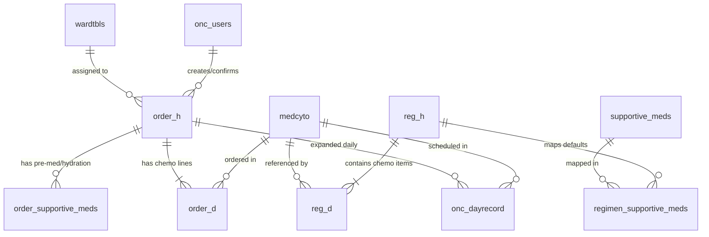

# เอกสารงานพัฒนาระบบ COPS (Chemotherapy Ordering & Preparation System)

> **ชื่อระบบ:** COPS™ Oncology — ระบบบริหารจัดการคำสั่งใช้ยา การเตรียมยา และการบริหารยาเคมีบำบัดชนิดฉีด  
> **หน่วยงาน:** Sterile Products Pharmacy Service, SPR Hospital  
> **เทคโนโลยีหลัก:** Laravel 12 (PHP 8.3.30 / MAMP), MySQL (`oncospr`), Bootstrap 5, JavaScript (ES6 / Fetch AJAX), JsBarcode  
> **อัปเดตล่าสุด:** 20 พฤศจิกายน 2026 (Version 1.5)

---

## 1. ภาพรวมและวัตถุประสงค์ของระบบ (System Overview)

ระบบ **COPS (Chemotherapy Ordering & Preparation System)** พัฒนาขึ้นเพื่อยกระดับความปลอดภัยด้านยาเคมีบำบัดชนิดฉีด (High-Alert Medications) ครอบคลุมกระบวนการทำงานแบบครบวงจรตั้งแต่:

1. **แพทย์ (Doctor Ordering):** เลือกสูตรยา (Regimen) หรือสั่งยาแบบอิสระ, คำนวณ BSA (Mosteller) & GFR (Cockcroft-Gault), ปรับลดขนาดยาแบบทั้งสูตรหรือแยกเฉพาะรายตัวพร้อมเหตุผลทางคลินิก, ปัดขนาดยาแบบ Clinical Dose Banding, ตรวจสอบประวัติ Cycle อัตโนมัติ, และสั่งใช้ Pre-medication / Pre-hydration
2. **เภสัชกร (Pharmacist Verification & Preparation):** รับคำสั่งใช้ยาแบบ Real-time, ตรวจสอบคำสั่งและกำหนดลำดับการให้ยา, ยืนยันรับคำสั่ง (Confirm) พร้อมแตกคำสั่งใช้ยาออกเป็นตารางรายวัน (`onc_dayrecord`), พิมพ์ใบจัดยา Working Formula (A5 แนวนอน) และสติกเกอร์ยาเคมีบำบัดขนาดมาตรฐาน 9 × 7 cm พร้อม Barcode `or_id` และลำดับการให้ยา `1/3, 2/3, 3/3`
3. **พยาบาล (Nurse Administration):** ตรวจสอบรายการยาที่ต้องให้ตรงวัน (ไม่ปะปนกับวันถัดไป) จัดกลุ่มตามผู้ป่วย (HN & ชื่อ-นามสกุล) แสดงลำดับการทำงานจริง (**Pre-medication → Pre-hydration → Chemotherapy**), ข้อควรระวัง High-Alert และยืนยันการบริหารยา (5 Rights)
4. **ผู้ดูแลระบบ (Admin & Superadmin):** จัดการฐานข้อมูลยาเคมีบำบัด (`medcyto`), สูตรยาเคมีบำบัดมาตรฐาน (`reg_h` / `reg_d`) พร้อมลำดับการให้ยาอัตโนมัติ, และบัญชีผู้ใช้งาน (`onc_users`)

---

## 2. สถาปัตยกรรมระบบและสิทธิ์การเข้าถึง (Architecture & RBAC)

### 2.1 โครงสร้างทางเทคนิค (Tech Stack)
- **Backend Framework:** Laravel 12 MVC (Controllers + Eloquent Models + Blade Views) — *ไม่ได้ใช้ Livewire*
- **Frontend:** Bootstrap 5.3 + Bootstrap Icons + Sarabun Font + Vanilla JavaScript (ES6 + Fetch API) + JsBarcode (CODE 128 + Code 39 SVG Fallback)
- **Database:** MySQL (`oncospr`, `utf8mb4_unicode_ci`) ผ่าน MAMP Socket (`/Applications/MAMP/tmp/mysql/mysql.sock`, Port `8889`)

### 2.2 สิทธิ์การใช้งานตามบทบาท (Role-Based Access Control)

| Role | หน้าหลัก (`/home`) | ระบบแพทย์ (`/doctor`) | ระบบเภสัชกร (`/pharmacist`) | ระบบพยาบาล (`/nurse`) | จัดการ `medcyto` & `regimens` | จัดการผู้ใช้ (`/users`) |
| :--- | :---: | :---: | :---: | :---: | :---: | :---: |
| **`superadmin`** | ✅ | ✅ | ✅ | ✅ | ✅ | ✅ |
| **`admin`** | ✅ | ✅ | ✅ | ✅ | ✅ | ❌ |
| **`doctor`** | ✅ | ✅ | ❌ | ❌ | ❌ | ❌ |
| **`pharmacist`** | ✅ | ❌ | ✅ | ❌ | ❌ | ❌ |
| **`nurse`** | ✅ | ❌ | ❌ | ✅ | ❌ | ❌ |

---

## 3. โครงสร้างฐานข้อมูล (Database Schema — `oncospr`)

### 3.1 แผนภาพความสัมพันธ์ข้อมูล (ER Diagram)

### 3.2 รายละเอียดตารางฐานข้อมูลทั้งหมด (15 ตาราง)

#### กลุ่มที่ 1: ตารางคำสั่งใช้ยาและการบริหารยารายวัน (Transaction Tables)
1. **`order_h` (Order Header — หัวใบคำสั่งใช้ยา)**
   - **PK:** `or_id` (`varchar(20)`)
   - **คอลัมน์สำคัญ:** `or_guid`, `or_hn`, `or_patname`, `or_age`, `or_sex`, `or_wt`, `or_ht`, `or_bsa`, `or_scr`, `or_gfr`, `or_reg_code`, `or_cycle`, `or_date`, `or_ward`, `or_confirm` (0=รอรับ, 1=รับแล้ว), `or_adjust_percent`, `or_adjust_reason`, `or_doctor_id`, `or_doctor_name`, `or_pharmacist_id`, `or_pharmacist_name`, `or_confirmed_at`
2. **`order_d` (Order Detail — รายการยาเคมีบำบัดในคำสั่ง)**
   - **FK:** `or_id` → `order_h.or_id`, `or_medcode` → `medcyto.dg_code`
   - **คอลัมน์สำคัญ:** `or_orderno` (ลำดับการให้ยา), `or_medcode`, `or_std_dose`, `or_reduce_pct` (% ลดเฉพาะตัว), `or_meddose` (Final Dose mg), `or_medunit`, `or_soln`, `or_solvol`, `or_medroute`, `or_medtime`, `or_start`, `or_stop`, `or_duration`, `or_working` (mL ดูดยา), `or_totalvol` (mL รวม), `or_text`, `or_cf`
3. **`onc_dayrecord` (Daily Administration Schedule — ตารางแตกคำสั่งรายวัน)**
   - แตกจาก `order_d` ตามช่วงวันที่ `or_start` ถึง `or_stop` เมื่อเภสัชกรกด Confirm
   - **คอลัมน์สำคัญ:** `or_id`, `or_daterec` (วันที่ให้ยาจริง), `or_orderno`, `or_medcode`, `or_meddose`, `or_working`, `or_totalvol`, `or_text` (เช่น `Day 1/2`), `or_check`, `or_prep` (0=กำลังเตรียม, 1=เตรียมพร้อม), `or_send` (0=ยังไม่ให้, 1=บริหารยาแล้ว)
4. **`order_supportive_meds` (ยาสนับสนุนที่แพทย์สั่งจริงในแต่ละใบสั่งยา)**
   - **FK:** `or_id` → `order_h.or_id`
   - **คอลัมน์สำคัญ:** `sm_code`, `sm_name`, `category` (`pre_med_antiemetic`, `pre_med_hypersensitivity`, `pre_hydration`, *(รองรับ `post_hydration`, `home_med`)*), `dose`, `route`, `instruction`, `sort_order`

#### กลุ่มที่ 2: ตารางสูตรยาและข้อมูลหลัก (Master Tables)
5. **`medcyto` (บัญชียาเคมีบำบัด — PK: `dg_code`)**
   - คอลัมน์: `dg_code`, `dg_name`, `dg_brand`, `dg_fullname`, `dg_conc` (mg/mL), `dg_vol` (mL/vial), `dg_price`, `dg_saleprc`, `dg_recon`, `dg_precaution` (High-Alert), `dg_exprecon`, `dg_expdilute`, `dg_time`
6. **`reg_h` (Regimen Header — PK: `rh_id`)** — `rh_code`, `rh_used`, `rh_created`
7. **`reg_d` (Regimen Detail)** — `rd_id` → `reg_h.rh_id`, `rd_orderno` (ลำดับการให้ยาในสูตร), `rd_medcode`, `rd_meddose`, `rd_medunit`, `rd_sol`, `rd_solvol`, `rd_medroute`, `rd_medtime`, `rd_start`, `rd_duration`
8. **`supportive_meds` (บัญชียาสนับสนุน — PK: `id`, Unique: `sm_code`)**
   - เก็บรายการ Pre-medication (Antiemetics 6 รายการ, Anti-Hypersensitivity 5 รายการ) และ Pre-hydration (6 รายการ) พร้อม `dose_options` (JSON ปุ่มเลือกขนาดยาด่วน)
9. **`regimen_supportive_meds` (ตารางผูกค่าเริ่มต้น Pre-med / Hydration กับ Regimen)**
   - เชื่อม `rh_id` ↔ `sm_code` พร้อม `override_dose`, `override_route`, `override_instruction`, `is_default`
10. **`onc_users` (ผู้ใช้งานระบบ)** — `username`, `name`, `email`, `role`, `license_no`, `department`, `is_active`, `password`
11. **ตารางอ้างอิงพื้นฐาน:** `units` (`un_code`, `un_unit`), `solutions` (`so_code`, `so_name`), `routes` (`rt_code`, `rt_name`), `timing` (`tm_code`, `tm_time`), `wardtbls` (`wd_code`, `wd_name`)

---

## 4. โครงสร้างไฟล์โค้ดหลักของระบบ (Codebase Map)

| ชั้นงาน | ไฟล์หลัก | หน้าที่ความรับผิดชอบ |
| :--- | :--- | :--- |
| **Routes** | `routes/web.php` | กำหนดเส้นทางและ Role Middleware ทั้ง 6 กลุ่ม |
| **Controllers** | `DoctorController.php` | สั่งใช้ยา, เช็คประวัติ Cycle (`/doctor/patient-history`), บันทึกคำสั่ง+Pre-med/Hydration |
| | `PharmacistController.php` | รับคำสั่ง, Real-time Polling, กำหนดลำดับยา, Confirm แตกวัน, พิมพ์ใบจัดยา/สติกเกอร์ |
| | `NurseController.php` | แสดงรายการให้ยาตรงวันแบบจัดกลุ่มผู้ป่วย, แสดง Pre-med/Hydration, ยืนยันให้ยา 5 Rights |
| | `MedcytoController.php` | CRUD บัญชียาเคมีบำบัด (`medcyto`) พร้อมตรวจ Referential Integrity ก่อนลบ |
| | `RegimenController.php` | จัดการสูตรยา Regimen และลำดับการให้ยา (`rd_orderno`) |
| | `AuthController.php` | Login/Logout และจัดการผู้ใช้งาน (`onc_users`) |
| **Views** | `resources/views/home.blade.php` | หน้าหลักแสดงสถิติเฉพาะวันปัจจุบัน + ยอดสะสมทั้งหมด |
| | `resources/views/doctor/{index,create,show}.blade.php` | ระบบแพทย์ (กรองวันที่, สั่งยา+คำนวณ+ลดขนาดรายตัว+Pre-med+Pre-hydration, ใบสั่งยา) |
| | `resources/views/pharmacist/{index,show,daily-stickers,print-labels,print-working-formula}.blade.php` | ระบบเภสัชกร (กรองวันที่, Real-time, ลำดับยา, สติกเกอร์ 9×7 cm + Barcode) |
| | `resources/views/nurse/index.blade.php` | ระบบพยาบาล (ตรงวัน, จัดกลุ่ม HN/ชื่อผู้ป่วย, Pre-med/Hydration, ยาย่อย) |
| | `resources/views/medcyto.blade.php`, `regimens/index.blade.php`, `admin/users.blade.php` | ระบบจัดการข้อมูลหลักสำหรับ Admin / Superadmin |

---

## 5. ประวัติการพัฒนาและการเปลี่ยนแปลงทุกขั้นตอน (Development Changelog)

| เวอร์ชัน | วันที่ | โมดูล / ส่วนงาน | รายละเอียดการเพิ่มและแก้ไข |
| :---: | :---: | :--- | :--- |
| **v1.0** | 16 พ.ย. 2026 | Core System | วางโครงสร้างฐานข้อมูล `oncospr` (utf8mb4), ระบบ Auth/RBAC (`onc_users`), ระบบแพทย์ (BSA/GFR/Dose Banding/Custom Order), ระบบเภสัชกร (Confirm แตกวัน, ใบจัดยา A5, ฉลากยา), ระบบพยาบาล, และ Regimen Master |
| **v1.1** | 17 พ.ย. 2026 | Nurse Station | ปรับหน้าพยาบาลให้แสดง **เฉพาะยาที่ให้ตรงวัน** (ไม่แสดงของวันถัดไป), จัดกลุ่มการ์ดตาม **HN และชื่อ-นามสกุลผู้ป่วย** พร้อมรายการยาย่อยด้านใต้ และปุ่มยืนยันให้ยาครบทุกรายการ |
| **v1.2** | 18 พ.ย. 2026 | Doctor & Pharmacist Index | เพิ่มช่องเลือกวันที่ (Default = ปัจจุบัน) ในหน้า `doctor/index` และ `pharmacist/index` เพื่อแสดงเฉพาะคำสั่งของวันที่เลือก พร้อมปรับ Real-time Polling ตามวันที่ |
| **v1.2.1** | 18 พ.ย. 2026 | Master Data (`medcyto`) | สร้างหน้า `medcyto.blade.php` และ `MedcytoController` สำหรับ CRUD ข้อมูลยาเคมีบำบัด จำกัดสิทธิ์ Admin & Superadmin พร้อมป้องกันการลบยาที่ถูกอ้างอิงแล้ว |
| **v1.3** | 18 พ.ย. 2026 | Stickers & Sequence | 1) กำหนดขนาดสติกเกอร์ทุกดวงเป็น **กว้าง 9 cm × สูง 7 cm** 2) เพิ่มคอลัมน์ `reg_d.rd_orderno` และระบบ **ลำดับการให้ยาอัตโนมัติ (แก้ไขได้ + ปุ่ม ▲/▼)** ในสูตร Regimen และช่องกรอกลำดับในหน้าเภสัชกรกรณีไม่มี Regimen 3) แสดงลำดับการให้ยาบนสติกเกอร์รูปแบบ **`1/3, 2/3, 3/3`** 4) สร้าง **Barcode (`or_id`)** (CODE 128 + Code 39 SVG Fallback) ด้านล่างสติกเกอร์สรุปรายการยา |
| **v1.3.1** | 18 พ.ย. 2026 | Doctor Cycle Auto-Check & Home | 1) เพิ่ม Endpoint `/doctor/patient-history` ตรวจสอบประวัติผู้ป่วยจาก `HN` และเติมค่า **Cycle ถัดไปอัตโนมัติ** (แพทย์แก้ไขได้) 2) ปรับการ์ดหน้าหลัก `home.blade.php` แสดงยอด **เฉพาะวันปัจจุบัน** เป็นตัวเลขหลัก และยอดสะสมเป็นตัวอักษรเล็กด้านล่าง 3) บันทึกกฎการรัน `php artisan serve` (MAMP PHP + Socket) ลง `AGENTS.md` |
| **v1.4** | 20 พ.ย. 2026 | Per-Drug Dose Reduction & Pre-medication | 1) เพิ่มปุ่มลัด **ปรับลดขนาดยาเฉพาะแต่ละตัวยา** (`0%` ถึง `-50%`) ใน `doctor/create` โดยคงแผงลดทั้งสูตรไว้ครบถ้วน 2) สร้างตาราง `supportive_meds`, `regimen_supportive_meds`, `order_supportive_meds` และพัฒนาระบบ **Pre-medication** (Antiemetics 6 รายการ + Anti-Hypersensitivity 5 รายการ พร้อมปุ่มปรับเพิ่มขนาด `Ondansetron inj.`) ผูกตาม Regimen และแสดงผลครบทั้ง แพทย์ / เภสัชกร / พยาบาล |
| **v1.5** | 20 พ.ย. 2026 | Pre-hydration | เพิ่มระบบ **Pre-hydration** (NSS, 5% D/NSS, KCl, MgSO4, 20% Mannitol, Furosemide) ผูกอัตโนมัติกับสูตร Cisplatin/AC และแสดงลำดับ **Pre-medication → Pre-hydration → Chemotherapy** ครบทั้ง แพทย์ / เภสัชกร / พยาบาล |

---

## 6. แผนการพัฒนาระยะถัดไป (Roadmap)

- [ ] **Phase 1.6:** พัฒนาส่วน **Post-hydration** (สารน้ำและอิเล็กโทรไลต์หลังให้เคมีบำบัด)
- [ ] **Phase 1.7:** พัฒนาส่วน **Home-medication** (ยากลับบ้าน เช่น Delayed Antiemetics / Dexamethasone / Ondansetron / Olanzapine)
- [ ] **Phase 2.0 (เมื่อได้รับอนุมัติ):** เชื่อมต่อระบบโรงพยาบาล **HOSxP** (ดึงข้อมูลผู้ป่วย, น้ำหนัก/ส่วนสูง, ผล Lab `SCr`/`CBC`, และประวัติแพ้ยาแบบ Read-Only อัตโนมัติ)
